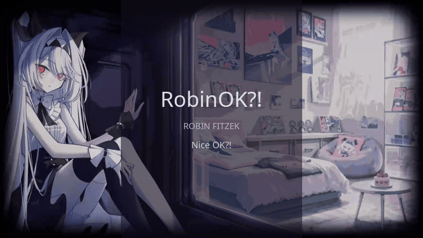

  

  

<h1 align="center">RobinOK?!</h1>

Robin Fitzek · Nice OK?!

  <a href="https://steamcommunity.com/profiles/76561198302793113/">Steam</a>
  &nbsp; · &nbsp;
  <a href="https://github.com/RobinFitzek?tab=repositories">Meine Projekte</a>

